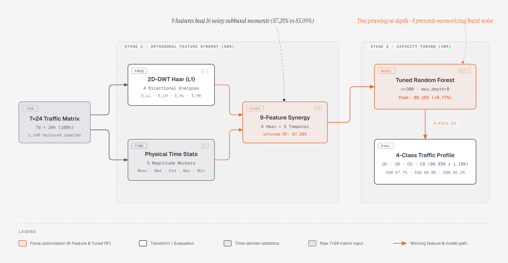
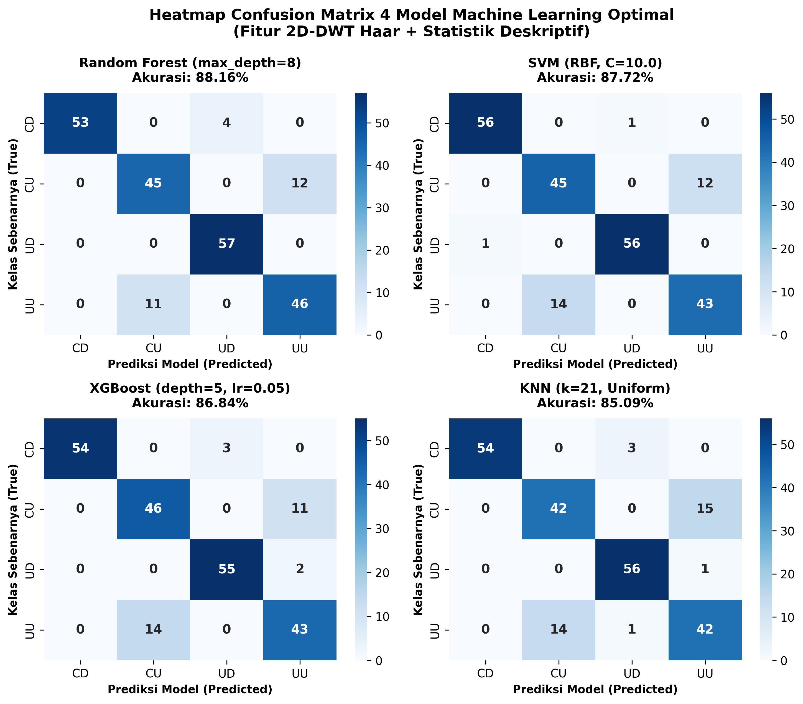
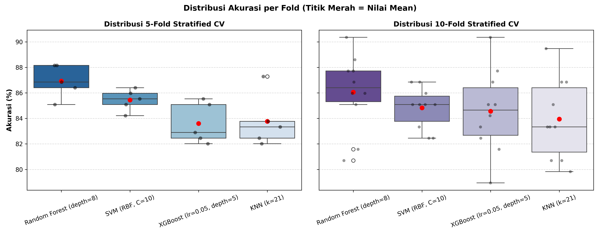
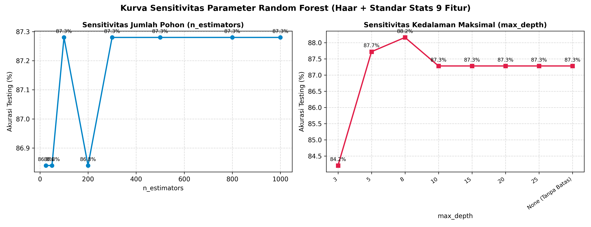
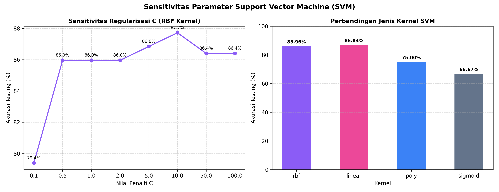
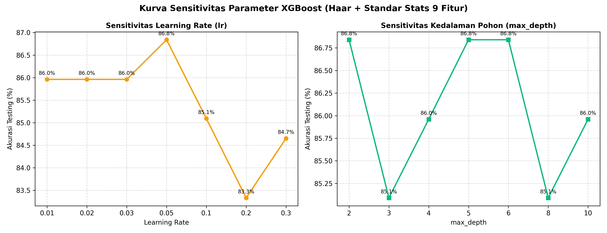
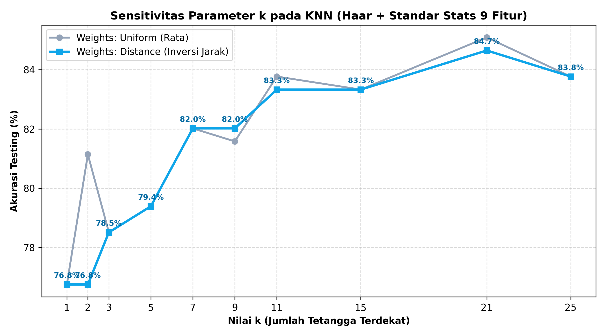

# Optimization of 2D-DWT Feature Engineering and Machine Learning Hyperparameters for Cellular Traffic Classification

[](https://www.python.org/)
[](https://scikit-learn.org/)
[](src/train_and_evaluate.py)
[](src/cross_validation.py)
[](LICENSE)

<p align="center">
  
</p>

---

## Abstract & Key Contributions

Representing weekly cellular network traffic as $7 \times 24$ spatio-temporal images captures both diurnal hourly cycles and day-of-week variations. However, relying solely on standard 4-subband 2D-DWT energy features yields a baseline classification accuracy of **79.39%** due to scale invariance loss after subband normalization.

This repository introduces a balanced **Two-Stage Optimization Framework**:

1. **Stage 1 — Spatio-Temporal 2D-DWT Feature Engineering:** We systematically evaluate mother wavelet bases (_Haar_ vs. _Daubechies db2_), higher-order subband moments (_skewness_, _kurtosis_), and an ablation study against pure time-domain statistics. We demonstrate that **9 hybrid features**—combining 4 orthogonal Level-1 **Haar 2D-DWT subband energies** (`E_LL`, `E_LH`, `E_HL`, `E_HH`) with 5 **physical time-domain statistics** (`Mean`, `Median`, `Std`, `Max`, `Min`)—boost baseline accuracy from **79.39% to 87.28%** while outperforming 16-feature higher-order subband expansions.
2. **Stage 2 — Capacity-Controlled Hyperparameter Optimization:** Through transparent sensitivity sweeps across four distinct ML paradigms (**Random Forest**, **SVM**, **XGBoost**, and **KNN**), we align model complexity to the 9-dimensional feature space, achieving a peak test accuracy of **88.16%** (`Random Forest, max_depth=8`) and verifying generalization via zero-leakage **Stratified 5-Fold and 10-Fold Cross-Validation**.

---

## Dataset Overview

The dataset comprises **1,140 weekly cellular throughput matrices** ($7 \text{ days} \times 24 \text{ hours} = 168 \text{ hourly pixels}$), balanced across 4 classes (285 matrices per class):

| Class Code | Traffic Profile | Description                                   |
| :--------: | :-------------- | :-------------------------------------------- |
|   **UU**   | _User Uplink_   | Per-user average uplink throughput pattern    |
|   **UD**   | _User Downlink_ | Per-user average downlink throughput pattern  |
|   **CU**   | _Cell Uplink_   | Aggregate cell-level uplink throughput load   |
|   **CD**   | _Cell Downlink_ | Aggregate cell-level downlink throughput load |

---

## Experimental Results

### Stage 1: Feature Engineering & Ablation Study (7 Scenarios)

Evaluated on an independent 20% stratified test split using baseline classifier configurations:

|   ID    | Feature Engineering Scenario           |  Dim  | Random Forest |  XGBoost   | SVM (RBF)  | KNN ($k=5$) | Key Finding                          |
| :-----: | :------------------------------------- | :---: | :-----------: | :--------: | :--------: | :---------: | :----------------------------------- |
| **S-1** | Baseline Haar 2D-DWT Energies          |   4   |    79.39%     |   76.75%   |   76.32%   |   72.37%    | Frequency baseline                   |
| **S-2** | Daubechies $db2$ 2D-DWT Energies       |   4   |    78.95%     |   77.63%   |   75.88%   |   74.12%    | Smooth wavelet blurs step boundaries |
| **S-3** | Haar + Subband Stats (Skew/Kurt)       |  16   |    85.09%     |   82.02%   |   80.70%   |   69.74%    | High-order moments induce noise      |
| **S-4** | $db2$ + Subband Stats (Skew/Kurt)      |  16   |    85.96%     |   82.02%   |   81.14%   |   70.18%    | Curse of dimensionality on KNN       |
| **S-5** | Pure Time-Domain Statistics (Ablation) |   5   |    85.53%     |   85.96%   |   85.53%   |   84.21%    | Lacks directional frequency context  |
| **S-6** | $db2$ + Physical Time-Domain Stats     |   9   |    85.53%     |   85.96%   |   86.84%   |   83.77%    | Strong hybrid ($db2$)                |
| **S-7** | **Haar + Physical Time-Domain Stats**  | **9** |  **87.28%**   | **86.84%** | **85.96%** | **79.39%**  | **Optimal Hybrid Representation**    |

### Stage 2: Hyperparameter Optimization (on Winning 9-Feature Set)

| Model             | Default Parameters                   | Optimal Parameters (Tuned)                   | Default Acc | **Tuned Peak Acc** | Gain ($\Delta$) |
| :---------------- | :----------------------------------- | :------------------------------------------- | :---------: | :----------------: | :-------------: |
| **Random Forest** | `n_estimators=300, max_depth=None`   | **`n_estimators=300, max_depth=8`**          |   87.28%    |     **88.16%**     |   **+0.88%**    |
| **SVM (RBF)**     | `kernel='rbf', C=1.0`                | **`kernel='rbf', C=10.0`**                   |   85.96%    |     **87.72%**     |   **+1.76%**    |
| **XGBoost**       | `n_estimators=300, lr=0.05, depth=6` | **`n_estimators=300, lr=0.05, max_depth=5`** |   86.84%    |     **86.84%**     |    _Stable_     |
| **KNN**           | `n_neighbors=5, weights='uniform'`   | **`n_neighbors=21, weights='uniform'`**      |   79.39%    |     **85.09%**     |   **+5.70%**    |

<p align="center">
  
</p>

### Stage 3: Zero-Leakage Stratified Cross-Validation (5-Fold & 10-Fold)

Evaluated via `Pipeline([('scaler', StandardScaler()), ('classifier', model)])` across all 1,140 samples:

| Model             | Optimal Configuration               | 5-Fold Stratified CV ($\mu \pm \sigma$) | 5-Fold Macro F1 | 10-Fold Stratified CV ($\mu \pm \sigma$) |
| :---------------- | :---------------------------------- | :-------------------------------------: | :-------------: | :--------------------------------------: |
| **Random Forest** | `n_estimators=300, max_depth=8`     |           **86.93% ± 1.16%**            |   **0.8690**    |            **87.54% ± 1.84%**            |
| **SVM**           | `kernel='rbf', C=10.0`              |           **85.44% ± 0.75%**            |   **0.8536**    |            **85.96% ± 1.71%**            |
| **KNN**           | `n_neighbors=21, weights='uniform'` |             83.77% ± 1.86%              |     0.8374      |              84.30% ± 2.26%              |
| **XGBoost**       | `lr=0.05, max_depth=5`              |             83.60% ± 1.43%              |     0.8357      |              85.09% ± 2.35%              |

<p align="center">
  
</p>

---

## Repository Structure

```text
cellular-traffic-dwt-classification/
├── README.md                                 # Project overview, benchmark tables, and usage guide
├── requirements.txt                          # Python dependencies
├── LICENSE                                   # MIT License
│
├── data/
│   ├── raw/                                  # Raw 7x24 weekly Excel matrices (UU, UD, CU, CD)
│   └── processed/                            # Extracted feature datasets (S1 through S7 CSVs)
│       └── dataset_feature_haar_standar_stats_9.csv  # Winning 9-feature dataset
│
├── src/                                      # Core reproducible pipeline
│   ├── extract_features.py                   # Extracts 4 Haar 2D-DWT energies + 5 physical statistics
│   ├── train_and_evaluate.py                 # Evaluates default vs. tuned models + confusion matrices
│   ├── sensitivity_analysis.py               # Hyperparameter sensitivity sweeps across 4 ML models
│   └── cross_validation.py                   # Zero-leakage 5-Fold & 10-Fold Stratified CV
│
├── experiments/                              # Ablation & multi-scenario comparisons
│   ├── run_all_feature_scenarios.py          # Reproduces Table 1 across all 7 feature scenarios
│   └── results/                              # Exported CSV evaluation tables
│
└── assets/                                   # Architecture diagrams, confusion matrices, and CV plots
```

---

## Quickstart & Reproducibility

### 1. Clone & Install Dependencies

```bash
git clone https://github.com/dhaafin/cellular-traffic-dwt-classification.git
cd cellular-traffic-dwt-classification
pip install -r requirements.txt
```

### 2. Run the Complete Pipeline

```bash
# Step 1: Extract the 9 hybrid features from raw 7x24 Excel matrices
python src/extract_features.py

# Step 2: Reproduce Stage 1 Benchmark (All 7 Feature Scenarios x 4 Models)
python experiments/run_all_feature_scenarios.py

# Step 3: Reproduce Stage 2 Tuned Evaluation (88.16% Peak Accuracy & Confusion Matrices)
python src/train_and_evaluate.py

# Step 4: Run Hyperparameter Sensitivity Sweeps (RF, SVM, XGBoost, KNN)
python src/sensitivity_analysis.py

# Step 5: Run Zero-Leakage 5-Fold & 10-Fold Stratified Cross-Validation
python src/cross_validation.py
```

---

## Hyperparameter Sensitivity Curves

<p align="center">
  
  
</p>
<p align="center">
  
  
</p>

---

## Citation

If you find this repository or benchmark useful in your research, please consider citing:

```bibtex
@misc{makhalingga2026dwt,
  author       = {Makhalingga, Dhaafin},
  title        = {Two-Stage Optimization of 2D-DWT Feature Engineering and Machine Learning Hyperparameters for Cellular Traffic Classification},
  year         = {2026},
  howpublished = {\url{https://github.com/dhaafin/cellular-traffic-dwt-classification}}
}
```
